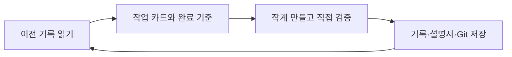

# smb-backup-lab

**Built with [dev-process-light](https://github.com/edubeom/dev-process-light)** — 작업 카드·직접 확인·기록·Git 저장을 실제 SMB 백업 개발에 적용했습니다.

Linux 서버의 프로젝트·설정·PostgreSQL·메일을 암호화해 **SMB 공유**에 저장하는 실제 개발 사례입니다. 프로젝트별 파일, 공유기 되읽기/복호화 확인, 최근 성공 한국 날짜5개 보관, 별도 DB 복구 검증을 다룹니다.



## dev-process-light가 쓰인 곳
|단계|실제 적용|
|---|---|
|light-resume/start|NOW/기능 지도 읽기, 기존 지시를 카드와 완료 기준으로 정리|
|light-check|합성 실패 시험과 실제 복구 결과를 분리, 미검증 범위 명시|
|light-save|흐름→목록→상세 기록, 단계별 저장|
|light-manual|설명서·강의 대본·방송 슬라이드 갱신|
|원인 조사|SMB 오류22, 초기 설정 기본값 호환을 재현해 수정|

원본 규칙/스킬을 포함했으며 [출처·고정 버전·라이선스 범위](NOTICE.md)를 보존했습니다. 적용기는 [사례 기록](docs/case-study.md)을 읽어 주세요.

## 강의·방송 자료
**26쪽 / 권장 본편21분55초 / 제작 기준2026-10-20**
- [PPTX — 발표자 노트 포함](media/broadcast/2026-10-20/smb-backup-lab-dev-process-light.pptx)
- [PDF](media/broadcast/2026-10-20/smb-backup-lab-dev-process-light.pdf)
- [전체 한국어 대본](media/broadcast/2026-10-20/speaker-notes.md)
- [진행표](media/broadcast/2026-10-20/broadcast-runbook.md) · [시연 순서](media/broadcast/2026-10-20/demo-script.md) · [유튜브 설명란](media/broadcast/2026-10-20/youtube-description.md)
- [전체 화면 미리보기](media/broadcast/2026-10-20/previews/contact-sheet.jpg)
- 오프라인 발표: 저장소를 받은 뒤 `media/broadcast/2026-10-20/lecture.html` 열기. P=발표, N=대본.

PPTX 화면은 이미지형으로 배치를 고정했고 노트는 편집 가능합니다. `scripts/build_broadcast.py`에서 내용을 바꿔 재생성할 수 있습니다.

## 합성 시험
Python3·GnuPG·Linux 환경에서 관리자 권한 없이 실행합니다. 실제 공유기/DB/메일 인증은 필요 없습니다.
```bash
python3 -m unittest discover -s tests -v
```
공개본에서123개 시험 통과를 확인합니다. 실제 사례의 PG5개/우편함7개와 구분하며 [검증 범위](docs/case-study.md)를 읽어 주세요.

## 구현과 적용 범위
- `src/`: 독립 암호화 객체, 원격 되읽기, 승인된 보관 정리, 격리 DB 복구
- `scripts/`: 수집·연결·운영·복구 확인. 기본 계획과 명시적 적용 구분
- `systemd/`: 매일04:00 Asia/Seoul 예약
- `config/backup.example.json`: 비활성 예제. 예시IP192.0.2.1과 demo-* 이름을 사용
- `docs/`: 백업/복구 절차·제약과 사례 기록

현재는 SMB 공유 대상의 특정 배포 사례입니다. 각 환경의 프로젝트·컨테이너·경로·SMB 버전을 확인하고 합성 시험/별도 복구를 거쳐 적용하세요. 운영 설치는 `/project/smb-backup-lab` 배포 위치를 기준으로 한 예제이며 원본 서버의 접근 정보는 없습니다.

제작 시점 첫 백업·설정/메일 읽기·PG복원·외부 키 재입력·일일 예약 활성까지 확인했습니다. 첫 예약 성공, 부팅 연결, Mailu 전체 로그인/송수신, 앱/보존 볼륨 전체 복구는 미검증입니다. 라이브 데이터의 전체 공통 시점을 보장하지 않으며 SMTP 큐 검사 실패 시 기존 성공본을 유지합니다.

## 공개와 비밀
실제 자격증명/키/메일/DB/원본 조사/운영 Git 이력은 공개하지 않습니다. 예시로 바꾼 범위와 시험의 배포 경로 patch는 [공개본 설명](docs/publication.md)에 적었습니다. 녹음·영상 완성본·유튜브 업로드는 포함하지 않습니다.

연락처: hello@edubeom.com · 저장소: https://github.com/edubeom/smb-backup-lab
